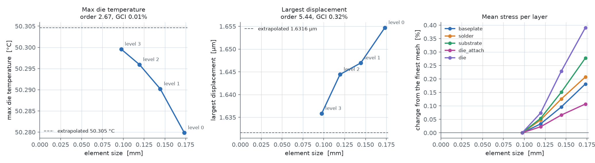
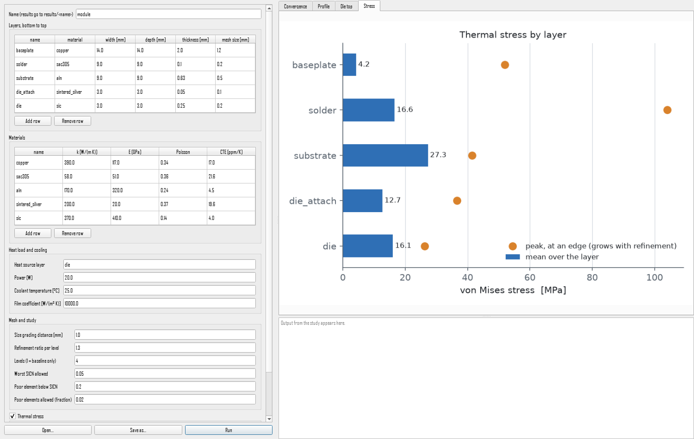
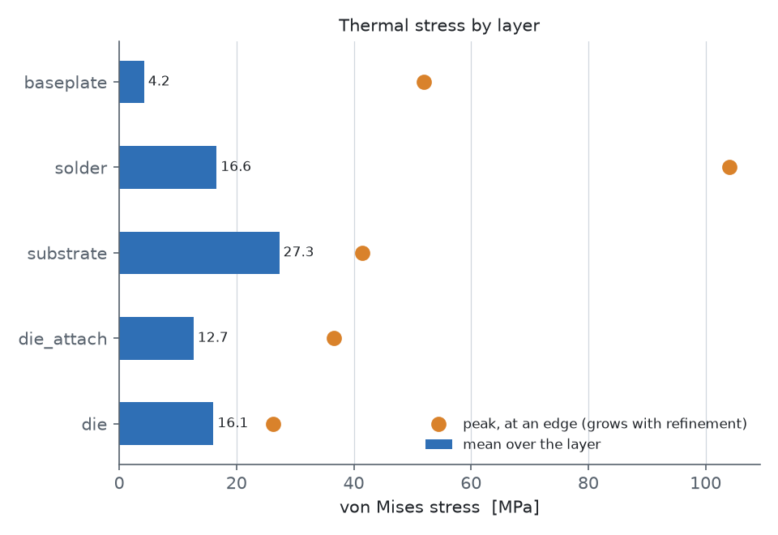
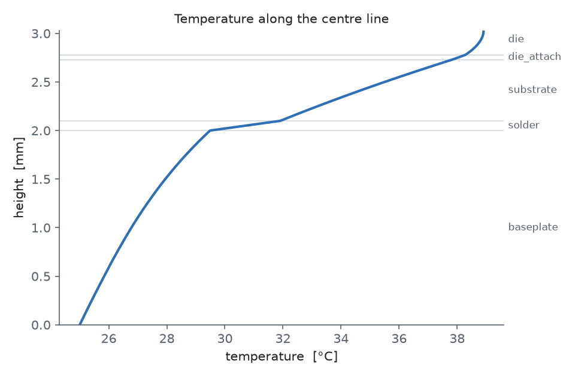

# stackfem

Heat flow and thermal stress in a layered power module stack, from one parameter
file to a converged answer.

- **Geometry.** Gmsh's OpenCASCADE kernel builds the stack (baseplate, solder,
  substrate, die attach, die) as boxes fused at every interface.
- **Mesh.** Gmsh size fields put small elements in the thin solder and die-attach
  layers and grade back to coarse elements around them. Every mesh is quality
  checked before it is solved, and a poor one stops the run.
- **Heat flow.** CalculiX solves the steady heat flow with quadratic tetrahedra.
  Heat leaves through the bottom of the baseplate, either into a coolant through a
  heat transfer coefficient or into an ideal cold plate.
- **Thermal stress.** The temperatures are then applied to an elastic model of the
  same mesh, which gives the displacements and the stress in every layer.
- **Study.** The same model is meshed and solved at several refinement levels.
  Each result is extrapolated to zero element size, with an error band.
- **Plots.** One post-processing script turns any results folder into the
  convergence plots, a centre-line temperature profile, a map of the die top and
  the stress in each layer.



## Setup

Python 3.11 or newer, and CalculiX's `ccx`.

```bash
python -m venv .venv
.venv/Scripts/pip install -e ".[dev]"     # .venv/bin/pip on Linux and macOS
```

CalculiX:

- **Linux:** `sudo apt install calculix-ccx`
- **macOS, Linux or Windows:** from conda-forge,
  `micromamba create -p ~/calculix -c conda-forge calculix`. Activate the
  environment, or on Windows put both `Library\bin` and `Library\mingw-w64\bin` on
  `PATH`.

If `ccx` is not on `PATH`, set `STACKFEM_CCX` to its full path.

## Use

```bash
stackfem geometry params/module.toml   # write the stack as a STEP file
stackfem mesh params/module.toml       # mesh level 0 and print its quality, no solve
stackfem run params/module.toml        # the baseline: mesh, check and solve level 0
stackfem study params/module.toml      # every level, then the convergence report
stackfem post params/module.toml       # redo the report and plots from saved results
```

`mesh` and `run` take `--level n`. Every command takes `--out folder`; by default
results go to `results/<name>/`.

### The window

```bash
pip install -e ".[gui]"
stackfem-gui                           # opens params/module.toml
stackfem-gui my_stack.toml
```

A form on the left holds every parameter: the layers and materials as tables,
then the load, cooling, mesh, study and stress settings. **Run** checks the form,
writes it to `results/<name>/form.toml` and runs the study there, with its output
streaming into the log. When it finishes, the tabs show the convergence, profile,
die-top and stress plots. **Open…** and **Save as…** read and write parameter files;
a saved file keeps every value but not the comments. Set *Levels* to 1 for a quick
baseline run.



## The parameter file

[params/module.toml](params/module.toml) holds everything: each layer's material,
footprint, thickness and element size; each material's conductivity, stiffness,
Poisson's ratio and thermal expansion; the mesh grading and refinement ratio; the
quality limits; the heat load and cooling; how the stack is held; and the number
of study levels. Copy it to model a different stack. Units are mm, W and °C.

- **Cooling.** `sink` is the coolant temperature. With `film` (in W/(m² K)) the heat
  crosses a film into the coolant; without it the bottom is held at `sink`.
- **Stress.** The `[mechanics]` section turns the stress step on; delete it to skip
  it. `stress_free` is the temperature at which the stack carries no stress.
  `support = "flat"` keeps the baseplate bottom flat, as if clamped to a heat sink,
  while letting it slide sideways; `"free"` lets the whole stack bow.
- **Stress solver.** `solver = "direct"` is exact, but slow and memory hungry on
  fine meshes: on the example's level 2 (266,000 nodes) it ran for over 30 minutes
  and used 6.6 GB before it was stopped, where `"iterative"` took about 4 minutes.
  The iterative solver is close enough for the example study (see below). The
  default is `"direct"`.

## What comes out

```
results/module/
  params.toml           the parameter file the results came from
  level_0/ ...          one folder per level:
    mesh.msh              the mesh, to open in Gmsh
    module_thermal.inp    the heat-flow deck, and its .frd results for CalculiX GraphiX (cgx)
    module_stress.inp     the stress deck, and its .frd results
    result.npz            nodes, elements, temperatures, displacements and stresses
  summary.csv           one row per level with every tracked result
  convergence.txt       the same as tables, with the extrapolated answers
  convergence.png       each result against element size
  profile.png           temperature up the centre line
  top.png               temperature over the top of the die
  stress.png            mean and peak stress in each layer
```

## Results for the example module

20 W in a 3 × 3 mm SiC die on sintered silver, an AlN substrate, SAC305 solder and
a copper baseplate, cooled from below by a liquid at 25 °C (10,000 W/(m² K)). The
stack has no stress at 25 °C, and the baseplate bottom is held flat.

| level | nodes   | max die temperature (°C) | R_th (K/W) | mean solder stress (MPa) | mean die-attach stress (MPa) |
| ----- | ------- | ------------------------ | ---------- | ------------------------ | ---------------------------- |
| 0     | 87,361  | 50.280                   | 1.2640     | 16.64                    | 12.69                        |
| 1     | 150,940 | 50.290                   | 1.2645     | 16.62                    | 12.69                        |
| 2     | 266,166 | 50.296                   | 1.2648     | 16.61                    | 12.68                        |
| 3     | 489,404 | 50.300                   | 1.2650     | 16.60                    | 12.68                        |

Extrapolated to zero element size, the maximum die temperature is 50.305 °C
(observed order 2.67, grid convergence index 0.013%), the mean solder stress is
16.59 MPa (GCI 0.073%) and the mean die-attach stress 12.68 MPa (GCI 0.024%).
The whole study takes about 20 minutes on a laptop.



Two things to read carefully:

- **Peak stress grows without limit.** Where a stiff layer ends on a softer one,
  the elastic stress at the edge is infinite in theory. The peak solder stress rises
  from 84 to 104 MPa over the four levels and would keep rising. The study therefore
  tracks the mean stress in each layer, which converges, and shows the peak only to
  say where stress gathers.
- **The largest displacement converges less cleanly** (1.655 to 1.636 µm). The
  iterative solver's error in displacement, about 0.06%, is close to the change
  between levels, so its fitted order is unreliable. Use `solver = "direct"` when the
  displacement itself matters.

The model is linear elastic. Real solder and sintered silver creep and yield, so
these stresses are an upper bound for a first look, not a life prediction.



## Checks

```bash
pytest
```

The tests check the parameter file, the mesh (every layer fills its box, no
element is inverted, node order matches CalculiX), the quality gate, the
extrapolation, and full CalculiX runs against answers worked out by hand: a
three-layer slab with a fixed bottom and with convection, and a slab of one
material heated evenly, which must grow without stress under both supports. The
window's tests check that the form shows a file unchanged and that edits and bad
values reach the parameters. Solver tests are skipped without `ccx`, and window
tests without PySide6.

See [ARCHITECTURE.md](ARCHITECTURE.md) for how the code is laid out.
